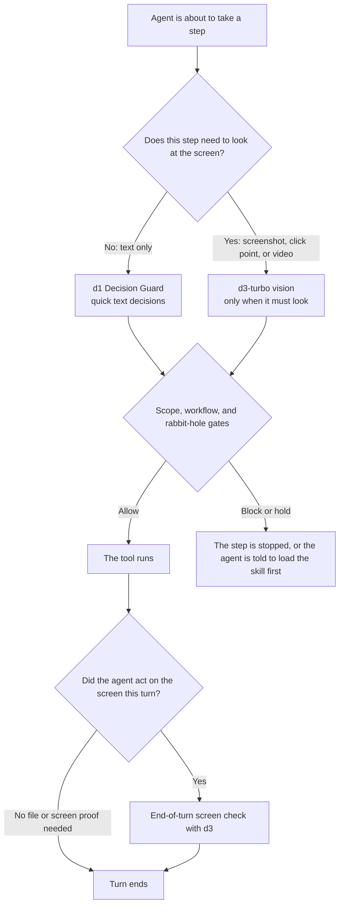

# Rails — keep any Hermes agent on what you asked for

Rails is a guardrails and decision plugin for [Hermes Agent](https://github.com/NousResearch/hermes-agent). Its main job is to keep **any** agent on the task you actually asked for — a question, a file, a coding change, or a screen task — and to show every decision it makes.

It uses a fast local "System 1" model for quick yes/no and multiple-choice calls, so the main model does not have to guess. Computer use and web browsing are a showcase of the same gates plus a vision model that can point at the screen, not the only thing Rails is for.

- **Scope gate** (`scope_mode`: `shadow` by default, or `block`): flags a tool call that is work you did not ask for, and flags a "rabbit hole" past `look_step_budget` steps on a look-only question. In `block` it stops the call; in `shadow` it only shows what it would have done.
- **Workflow gate** (`workflow_mode`): for code work, the agent is steered to load the matching skill first (the [superpowers](https://github.com/obra/superpowers) plugin if it is installed, otherwise Hermes's bundled skills), and "done" after code edits needs a test run.
- **Decide tool** (`decide`): the agent can ask the local decision models typed questions (yes/no, choice, score, and, when vision is on, box and track) and get a probability for every answer.
- **End-of-turn check**: after the agent has acted on the screen, a vision model looks at the newest screenshot and the result is shown as a tag. (Hermes only runs its `pre_verify` gate after file edits, so a screen-only turn is checked at the end of the turn. That end-of-turn check is a tag and a log line; it cannot send the agent back.)

Every decision is shown inline as a tag (⚖ ✅ ⛔ ❌) and written to a decision log.

## How a turn flows



**How routing actually works (v3):**

- **The gates always call d1.** The scope gate, workflow gate, rabbit-hole check, and turn classification all call d1 at `http://127.0.0.1:8089/v1/systemone`. You do not pick a model for those.
- **`decide` with `use="auto"` also starts at d1.** Text questions go to d1 first and only escalate to d3 when d1 is unsure (the same confidence bands the gates use). If the state itself already says the fact is missing, auto returns a mid / unknown answer and does not ask a model to guess.
- **`use="fast"` stays on d1.** **`use="smart"` or `use="vision"` goes straight to d3.**
- **Vision tools always use d3-turbo.** `screen_find`, `screen_check`, `video_check`, click-point advice, and the end-of-turn screen check talk to port 8899. They do not go through d1.

If a layer is off, Rails says so in plain words and never fakes an answer.

## What it does (and what it does not)

- **Scope gate** (`scope_mode`): at `pre_tool_call`, d1 classifies the user's ask (look-only vs. change) and whether the tool call is on-task. Look-only turns flag changes; any turn can flag a side quest. Past `look_step_budget` tool calls on a look-only question, Rails calls it a rabbit hole (computer-use turns are not counted toward that budget). `shadow` only shows a tag; `block` stops the call.
- **Workflow gate** (`workflow_mode`): d1 sorts the turn (bug / code change / new build / other). For code work, the matching skill should be loaded first; edits can be held until it is. After code edits, `pre_verify` refuses "done" until a test ran (or, if the check itself fails, it still will not rubber-stamp "done"). If the superpowers plugin is not installed, Rails falls back to Hermes's bundled skills and does not break.
- **Screen check** (`screen_check_mode`): after clicking, typing, or other computer-use actions, d3-turbo looks at the newest screenshot. `on` can send the agent back through `pre_verify` (file-edit turns). Screen-only turns get the end-of-turn tag described above. `shadow` only shows what it would do. `off` skips the check. If Computer Use Vision is down, the result is `unavailable` and the agent is told to say that plainly.
- **Computer-use gate** (`computer_use_mode`, default **`shadow`**): when the user asked for computer use, Rails can steer the agent to `computer_use` with d3 as its eyes, and can hold stand-in browsers. In `on`, clicks are meant to be backed by a d3 find/decide; that hold is skipped when the vision server is down, so the agent is not told to stop just because d3 is off. Keys, typing, scroll, and focus are not held for a click point. `jev_computer_use` is mentioned in block text only if that tool is actually registered.
- **Prompt-injection watch**: tool results are checked in the background. A hit is one ⚠ line and a log entry. It never blocks.
- **Hermes Tool Search**: lookups (`tool_search`, `tool_describe`) are not judged. When a deferred tool is run through `tool_call`, Rails judges the inner tool, not the wrapper.
- **Tools** (toolset `decisions`): `decide`, `screen_find`, `screen_check`, `video_check`.

All settings are editable in Hermes Desktop → Settings → Plugins → Rails. The **ports and model URLs are not settings**; they are fixed in the plugin (`d1` at `127.0.0.1:8089`, optional d3-ultra at `8898`, d3-turbo at `8899`). You must serve the models on those ports.

Optional `user_label` / `agent_label` settings default to "the user" / "the agent". A personal install can put names there; they are not hardcoded in the plugin.

## Requirements

- Hermes Agent `>=0.22.0`
- A local **d1** decision server at `http://127.0.0.1:8089` (Decision Guard). This is what the gates use.
- Optional **d3-turbo** (Computer Use Vision) at `http://127.0.0.1:8899` for `screen_find`, `screen_check`, `video_check`, click points, and the screen check before "done".
- Optional **d3-ultra** (Decision Second Opinion) at `http://127.0.0.1:8898`. Used when `second_opinion_mode` is on or in shadow and d1 is under 60% sure, and as a text backend for a `decide` escalation. On some GPUs, d3-ultra may not load beside d3-turbo at the same time, which is why this mode defaults to `off`.

When a layer is off, Rails names it and never invents an answer. The scope gate fails open if d1 cannot answer (the call goes ahead and the tag says ❌). The plugin still loads if none of the servers are running.

## Set up the local models

You have to start d1 (and d3, if you want vision) yourself. Rails does not download or launch them.

### What to get

| Layer | What Rails talks to | Official package | Weights on disk (from the model card) | Role |
| --- | --- | --- | --- | --- |
| **d1 Decision Guard** | `http://127.0.0.1:8089/v1/systemone` | [LiquidAI/d1-3B-GGUF](https://huggingface.co/LiquidAI/d1-3B-GGUF) | Q4_K_M is 1.67 GB; Q8_0 is 2.87 GB; plus a projector, e.g. `mmproj-d1-3B-Q8_0.gguf` (583 MB) | Quick text decisions for the gates; `decide` with `use="fast"` or auto text that stays on d1 |
| **d3-turbo vision** | `http://127.0.0.1:8899` (`/health`, `/v1/decisions`; the card also documents `/v1/systemone`) | [vllm-sr/d3-turbo-INT4](https://huggingface.co/vllm-sr/d3-turbo-INT4) (recommended starting point), [vllm-sr/d3-turbo-FP8](https://huggingface.co/vllm-sr/d3-turbo-FP8), or full [vllm-sr/d3-turbo](https://huggingface.co/vllm-sr/d3-turbo) | INT4: 16.6 GB. FP8: 31.9 GB. Full BF16: 52.2 GB | Screenshots, click points, video, screen check |
| **d3-ultra** (optional) | `http://127.0.0.1:8898/v1/systemone` | [vllm-sr/d3-ultra](https://huggingface.co/vllm-sr/d3-ultra) | A 4-bit / GPTQ package used in one working setup was about 16 GB on disk | Second opinion when d1 is unsure |

**Hardware, as stated on the cards (not guessed for your GPU):**

- d1-3B GGUF is a 3B decision model and is meant to run with llama.cpp's `llama-server`.
- d3-turbo-INT4's card: no special matrix units required; 16.6 GB of weights. The card's own speed benchmark on one AMD Instinct MI300X used up to **46.4 GiB** of GPU memory (vs 78.3 GiB for full d3-turbo). INT4 is for saving memory; the card says it is not faster than BF16 on that GPU, and to use **d3-turbo-FP8** for speed.
- d3-turbo-FP8's card: 31.9 GB of weights, and it **needs FP8 matrix units** (AMD Instinct MI300 / MI350, or NVIDIA compute capability 8.9 or later).

If your machine has less free GPU memory than the card's peak figures, start with d1 plus d3-turbo-INT4, and do not assume FP8 will load.

### 1. Download the models

d1 (official card: run with llama.cpp, files live in [LiquidAI/d1-3B-GGUF](https://huggingface.co/LiquidAI/d1-3B-GGUF)):

```bash
# Official card's server command also downloads the GGUF, default port 8080:
#   llama-server -hf LiquidAI/d1-3B-GGUF:Q8_0
# To pin the same files used in a working Windows setup (Q4_K_M + Q8_0 projector):
huggingface-cli download LiquidAI/d1-3B-GGUF d1-3B-Q4_K_M.gguf mmproj-d1-3B-Q8_0.gguf --local-dir ./d1-3B-GGUF
```

d3-turbo-INT4 (official card):

```bash
# Python (from the INT4 model card):
#   from huggingface_hub import snapshot_download
#   path = snapshot_download("vllm-sr/d3-turbo-INT4")
huggingface-cli download vllm-sr/d3-turbo-INT4 --local-dir ./d3-turbo-INT4
```

Optional, only if you have the hardware the FP8 card asks for:

```bash
huggingface-cli download vllm-sr/d3-turbo-FP8 --local-dir ./d3-turbo-FP8
```

### 2. Run d1 on port 8089

The official d1 card starts a server like this (port **8080** unless you change it):

```bash
llama-server -hf LiquidAI/d1-3B-GGUF:Q8_0
```

Rails expects port **8089**. A command that matches a working local setup (ROCm build of llama-server, Q4_K_M weights, two slots, 16k context) is:

```bash
llama-server -m /path/to/d1-3B-Q4_K_M.gguf --mmproj /path/to/mmproj-d1-3B-Q8_0.gguf --host 127.0.0.1 --port 8089 -ngl 99 -c 16384 -np 2
```

On Windows with a Radeon 8060S, that was the ROCm `llama-server.exe`. The official card's `/v1/systemone` examples still apply; change the port to 8089.

### 3. Run d3-turbo on port 8899 (optional, needed for vision)

From the INT4 model card, using the [vLLM Semantic Router](https://github.com/vllm-project/semantic-router) model runtime (the card says a Hub package that is not built in needs a full 40-hex `--revision`; video requests need `--max-request-bytes` above the default 8 MiB):

```bash
# in a checkout of vllm-project/semantic-router
pip install -e "src/model-runtime[multimodal]" flash-linear-attention
vllm-srun serve vllm-sr/d3-turbo-INT4 --revision 6a5282347853a4bfb39e6762a653bef6b5f06140 --port 8899 --max-request-bytes 67108864
```

If you already downloaded the package to a folder, serve that folder the same way (`vllm-srun serve /path/to/d3-turbo-INT4 --port 8899 --max-request-bytes 67108864`, plus any device flags your runtime needs).

**Windows note (one working setup, not the only way):** on a Windows 11 PC with an AMD Radeon 8060S, d3-turbo-INT4 was served inside Ubuntu-24.04 WSL through Docker, image `ghcr.io/vllm-project/semantic-router/vllm-sr-rocm:nightly-20261026`, publishing `127.0.0.1:8899`, with the model files on a local drive. The launch used AMD's WSL container flags (`/dev/dxg`, `HSA_ENABLE_DXG_DETECTION=1`, `ROCPROFILER_REGISTER_ENABLED=0`) and:

```bash
vllm-srun serve /models/d3-turbo-int4 --device rocm --host 0.0.0.0 --port 8899 --max-request-bytes 67108864
```

The first load took several minutes. The health check for that setup talks to `http://127.0.0.1:8899/health` and expects `"status": "ready"`.

Do not start d3-ultra on 8899 at the same time as d3-turbo; Rails wants ultra on **8898** if you use it at all.

### 4. Quick check that the models answer

d1 (from the d1 card, port changed to 8089):

```bash
curl http://127.0.0.1:8089/v1/systemone -H "Content-Type: application/json" -d "{\"state\":\"I was charged twice this month, please refund one of them.\",\"questions\":{\"refund\":{\"type\":\"noul\",\"instructions\":\"Is the customer asking for a refund?\"}}}"
```

You should get JSON with `answers` and probabilities, not generated prose.

d3 (health check, plus the INT4 card's sample request):

```bash
curl http://127.0.0.1:8899/health
# expect status ready / ok

curl -s http://127.0.0.1:8899/v1/systemone -H "content-type: application/json" -d "{\"model\":\"vllm-sr/d3-turbo-INT4\",\"state\":\"Write a Python function that reverses a string.\",\"questions\":{\"kind\":{\"type\":\"choice\",\"instructions\":\"What kind of work is this?\",\"criteria\":{\"code\":\"Writing or fixing code\",\"math\":\"Mathematics\",\"chat\":\"Anything else\"}}}}"
```

If port 8089 or 8899 has no server, Rails will not crash Hermes. Gates that need d1 will fail open and say so; vision tools will return an error that names the server and port to start.

### 5. Rails settings (Hermes Desktop → Settings → Plugins → Rails)

These are the config keys the plugin reads (from `config_schema` / `apply_settings`):

| Key | Default in the plugin | Meaning |
| --- | --- | --- |
| `scope_mode` | `shadow` | `shadow` or `block` |
| `workflow_mode` | `on` | `on`, `shadow`, or `off` |
| `screen_check_mode` | `shadow` | `on`, `shadow`, or `off` |
| `computer_use_mode` | `shadow` | `on`, `shadow`, or `off` |
| `second_opinion_mode` | `off` | `on`, `shadow`, or `off` |
| `look_step_budget` | `8` | tool-call budget on a look-only question |
| `user_label` | `the user` | what model-facing text calls the user |
| `agent_label` | `the agent` | what model-facing text calls the agent |

There is no setting for host, port, or model id. Put d1 on 8089 and d3-turbo on 8899.

## Ask your own agent to set this up

Copy and paste this to Hermes (or another agent) on the machine that will run the models. It is written so the agent uses the official cards and then pins Rails' ports; it should not invent flags.

```
Set up the local models for the Hermes plugin "Rails" (github.com/grimmjoww/hermes-rails) on this computer. Do not pay for anything, do not change Rails source, and do not start a download until you have told me the disk and GPU memory you would use and I say yes.

Goal:
- d1 (LiquidAI/d1-3B-GGUF) answering at http://127.0.0.1:8089/v1/systemone
- optional d3-turbo vision answering at http://127.0.0.1:8899 (health status ready)
- optional d3-ultra only if I ask, on port 8898, not 8899

Do this in order:
1. Read the official model cards, do not guess commands:
   - https://huggingface.co/LiquidAI/d1-3B-GGUF
   - https://huggingface.co/vllm-sr/d3-turbo-INT4
   - https://huggingface.co/vllm-sr/d3-turbo-FP8 (only if I have the FP8 hardware that card lists)
   - https://huggingface.co/vllm-sr/d3-turbo
   - https://huggingface.co/vllm-sr/d3-ultra if we are also setting up the second opinion
2. Tell me what is already listening on ports 8089, 8898, and 8899. Do not kill a process you did not start.
3. Recommend one d3 package from those cards based on this machine's actual GPU and free memory. Prefer INT4 unless I clearly have the FP8 units the FP8 card requires. Quote the card's weight size and any GPU-memory figure, and say if that figure is from the card's MI300X benchmark rather than this PC.
4. After I approve, download only the files we agreed (huggingface-cli or snapshot_download as the card shows).
5. Start d1 on port 8089 (the d1 card uses 8080 by default; change the port). Start d3 with vllm-srun as the INT4 card shows, on port 8899, with --max-request-bytes 67108864. On Windows, if we need WSL/Docker, use a documented vLLM Semantic Router ROCm path and keep the API on 127.0.0.1:8899.
6. Prove they work with the curl examples from those cards (d1 /v1/systemone on 8089; d3 /health and a small /v1/systemone request on 8899). Show me the JSON. Do not fake a passing check.
7. Install Rails if it is not already there: copy or clone https://github.com/grimmjoww/hermes-rails, run `hermes plugins validate . --install-deps`, enable it in Hermes, and leave the model URLs alone (they are not config keys).

If a model will not load, stop and say what failed. Never silently swap in a different model or port.
```

## Install Rails

Copy this folder into your Hermes plugins folder as `rails` (on Windows: `%LOCALAPPDATA%\hermes\plugins\rails`), then restart Hermes and enable it under Settings → Plugins.

Validate it with:

```
hermes plugins validate /path/to/rails --install-deps
```

## A non-browser example

Rails is for any turn, not only the browser. A look-only question such as "Does this README mention the MIT license? Do not edit any file" should be classified as look-only. A write or patch on that turn is off-task: in `shadow` you get a ⚖ tag, and in `block` the call is stopped. Code-change turns are a different path: the workflow gate wants the matching skill loaded first, and "done" after edits wants a real test run.

Computer use and web browsing use the same gates, plus d3 on the screenshot (`screen_find` / `screen_check`) and the end-of-turn screen check.

## Disclosures

- **Network:** only to the local model servers above on `127.0.0.1` (ports 8089, 8898, 8899). No third-party services, no telemetry.
- **Files:** appends a decision log to `<HERMES_HOME>/logs/rails.jsonl` (long tokens are masked). Reads the newest computer-use screenshot, and images/videos passed to its tools, to send them to the local vision model. Reads skill names from the sibling `superpowers` plugin folder if present, and falls back to Hermes bundled skills if it is not.
- **Background threads:** short-lived daemon threads for the second-opinion and injection checks.
- **No shell commands, no stored credentials, no self-updating code.**

## Tests

```
pytest tests
```

## License

MIT — see [LICENSE](LICENSE).

Author: Willie Stewart ([grimmjoww](https://github.com/grimmjoww)).
